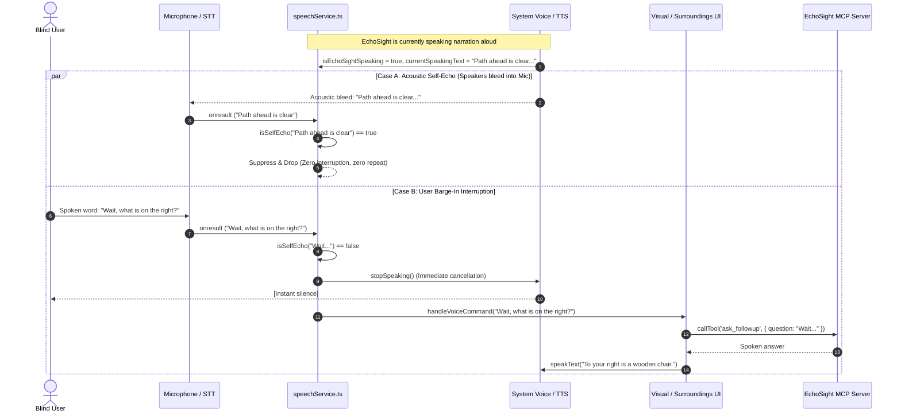
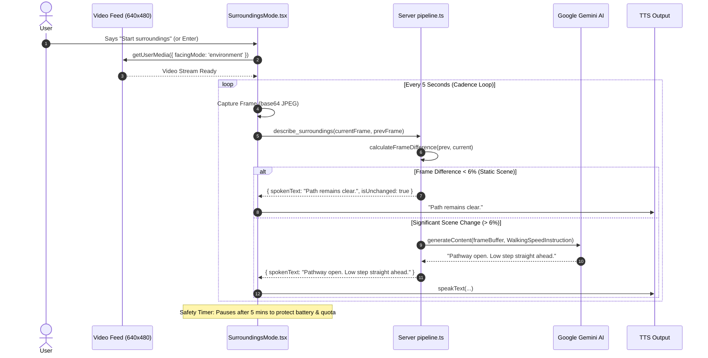
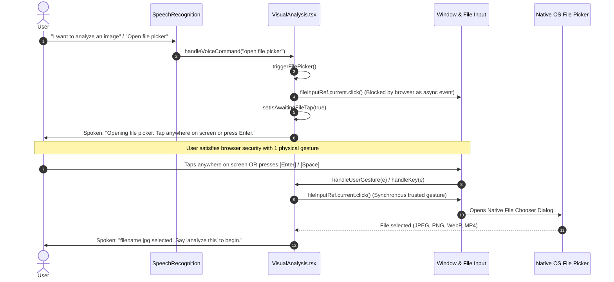

# EchoSight — Comprehensive Project Implementation & Architecture Document

> **EchoSight** is an open-source, voice-first ambient visual, video, and spatial co-pilot built for blind and low-vision individuals. Developed for the **Alexa+ Track** of the Amazon *"Build, Ship, Shape"* Developer Hackathon, EchoSight replaces traditional visual-centric interfaces with an autonomous, voice-driven sighted companion that speaks, listens, reasons, and navigates in real time.

---

## Table of Contents
1. [Executive Summary & Mission](#1-executive-summary--mission)
2. [Alexa+ & MCP System Architecture](#2-alexa--mcp-system-architecture)
3. [End-to-End System Workflows & Mermaid Diagrams](#3-end-to-end-system-workflows--mermaid-diagrams)
4. [Complete Feature Catalog](#4-complete-feature-catalog)
   * [4.1 Voice Landing Gate & Zero-Friction Entrance](#41-voice-landing-gate--zero-friction-entrance)
   * [4.2 Surroundings Mode (Real-Time Spatial & Hazard Co-Pilot)](#42-surroundings-mode-real-time-spatial--hazard-co-pilot)
   * [4.3 Unified Visual & Video Analysis Hub](#43-unified-visual--video-analysis-hub)
   * [4.4 Zero-Touch Live Camera Snapshot](#44-zero-touch-live-camera-snapshot)
   * [4.5 Voice File Picker Bridge & Browser Sandbox Solution](#45-voice-file-picker-bridge--browser-sandbox-solution)
   * [4.6 Multi-Turn Conversational Q&A (Contextual Follow-ups)](#46-multi-turn-conversational-qa-contextual-follow-ups)
   * [4.7 Advanced Voice Engine: Barge-In & Self-Echo Suppression](#47-advanced-voice-engine-barge-in--self-echo-suppression)
5. [Backend MCP Server & Tool Suite](#5-backend-mcp-server--tool-suite)
6. [Resilient Multi-Model Gemini Pipeline](#6-resilient-multi-model-gemini-pipeline)
7. [Accessibility & Design Philosophy (WCAG AAA)](#7-accessibility--design-philosophy-wcag-aaa)
8. [Codebase Directory Structure](#8-codebase-directory-structure)
9. [Setup, Installation & Running Guide](#9-setup-installation--running-guide)

---

## 1. Executive Summary & Mission

### The Problem
Traditional computer vision and assistive applications suffer from major design flaws when used by blind or low-vision users:
* **Shallow One-Sentence Captions:** Most models output brief, robotic labels (e.g., *"A person standing near a table"*), failing to provide the spatial depth, orientation, hazard proximity, or layout needed for safe navigation.
* **Touch-Dependent Interfaces:** Many "assistive" apps still require users to locate on-screen buttons, browse complex directory dialogs, or tap to trigger speech.
* **Rigid Monologues:** When an assistant narrates, the user is trapped listening to a lengthy audio output with no ability to interrupt, clarify, or ask urgent questions.
* **Acoustic Feedback Loops:** Continuous speech recognition systems frequently pick up their own spoken output from the device's speakers, creating chaotic audio feedback and repeating sentences.

### The EchoSight Solution
EchoSight delivers a **100% voice-first, hands-free experience**:
* **Autonomous 5-Second Cadence:** Constantly inspects the user's path, warns of navigation hazards, and identifies landmark objects in punchy, walking-speed language.
* **Instant Barge-In Interruption:** When the user speaks even a single syllable while EchoSight is talking, EchoSight silences itself immediately to hear the user's question.
* **Acoustic Self-Echo Suppression:** Proprietary acoustic matching filters out EchoSight's own voice from the microphone, preventing stuttering or repetition.
* **Unified Multi-Modal Intelligence:** Seamlessly auto-detects and explains photographs, technical diagrams, cricket/sports scorecards, and video clips in patient, exhaustive detail.

---

## 2. Alexa+ & MCP System Architecture

EchoSight is architected according to the **Model Context Protocol (MCP)** specification (Spec 2025-11-25+, Streamable HTTP & SSE) and built for the **Alexa+ track**:

```
 ┌────────────────────────────────────────────────────────────────────────┐
 │                    CLIENT TIER (Next.js / Vite SPA)                    │
 │                                                                        │
 │  ┌───────────────────────┐             ┌─────────────────────────────┐ │
 │  │ Simulated Alexa+ Voice│             │ Web Speech API Engine       │ │
 │  │ Client (React 19)     │◄───────────►│ • Continuous STT            │ │
 │  └──────────┬────────────┘             │ • Natural TTS               │ │
 │             │                          │ • Barge-In Silence Matrix   │ │
 │             │ HTTP POST (RPC)          │ • Acoustic Self-Echo Filter │ │
 │             │ or SSE Stream            └─────────────────────────────┘ │
 └─────────────┼──────────────────────────────────────────────────────────┘
               │
               ▼
 ┌────────────────────────────────────────────────────────────────────────┐
 │                   SERVER TIER (Node.js / Express MCP)                  │
 │                                                                        │
 │  ┌──────────────────────────────────────────────────────────────────┐  │
 │  │ Dual Transport Layer                                             │  │
 │  │ • Streamable HTTP / Server-Sent Events (GET /sse, POST /messages)│  │
 │  │ • Direct RPC REST Gateway (POST /api/tools/:name)                │  │
 │  └──────────────────────────────────┬───────────────────────────────┘  │
 │                                     │                                  │
 │  ┌──────────────────────────────────▼───────────────────────────────┐  │
 │  │ EchoSight MCP Server Tool Registry                               │  │
 │  │ • describe_surroundings   • analyze_video                        │  │
 │  │ • analyze_visual          • analyze_scorecard                    │  │
 │  │ • ask_followup            • ping                                 │  │
 │  └──────────────────────────────────┬───────────────────────────────┘  │
 └─────────────────────────────────────┼──────────────────────────────────┘
                                       │
                                       ▼
 ┌────────────────────────────────────────────────────────────────────────┐
 │                      INTELLIGENCE & REASONING TIER                     │
 │                                                                        │
 │  ┌──────────────────────────────────────────────────────────────────┐  │
 │  │ Google Gemini Multi-Model Cascade (with Exponential Backoff)     │  │
 │  │ 1. gemini-2.5-flash / gemini-3.7-flash (Primary spatial & video) │  │
 │  │ 2. gemini-1.5-flash / gemini-3.5-flash-lite (Quota fallback)     │  │
 │  └──────────────────────────────────────────────────────────────────┘  │
 └────────────────────────────────────────────────────────────────────────┘
```

1. **Alexa+ MCP Server (`server/`):**
   * Implements the official `@modelcontextprotocol/sdk`.
   * Serves Streamable HTTP and Server-Sent Events (`/sse`, `/messages`) for native Alexa+ Agent integration.
   * Exposes REST endpoints (`/api/tools/:name`) for high-speed direct client tool calls.
2. **Simulated Alexa+ Voice Client (`client/`):**
   * Acts as an Alexa+ smart display / voice endpoint in the browser.
   * Connects via `mcpClient.ts` to dispatch JSON-RPC tool calls to the MCP server.
   * Completely voice-operable without mouse or keyboard requirement.

---

## 3. End-to-End System Workflows & Mermaid Diagrams

### Workflow 1: Voice Pipeline with Barge-In & Self-Echo Suppression
This diagram illustrates how user speech is processed while eliminating acoustic speaker feedback:



---

### Workflow 2: Surroundings Mode 5-Second Autonomous Cadence Loop
This diagram shows the continuous real-time spatial awareness loop:



---

### Workflow 3: Voice File Picker User Activation Bridge
How EchoSight satisfies Chromium's strict security policy (`File chooser dialog can only be shown with a user activation`):



---

## 4. Complete Feature Catalog

### 4.1 Voice Landing Gate & Zero-Friction Entrance
* **Purpose:** Ensures users who are blind or using screen readers are greeted immediately without cognitive clutter or premature browser permission prompts.
* **Blank Landing Slate:** Upon opening the application, the screen is clean, presenting only high-contrast branding and instructions.
* **Auto-Spoken Greeting:** EchoSight introduces itself: *"EchoSight. Voice-First Spatial and Visual Co-Pilot. Say Enter or tap anywhere to begin."*
* **Voice-Activated Entrance:** Saying *"enter"*, *"go"*, *"start"*, *"open"*, or *"continue"* enters the main application.
* **Physical Fallback:** Tapping anywhere on the screen or pressing <kbd>Enter</kbd> / <kbd>Space</kbd> enters immediately.
* **Security & Permission Gate:** Guarantees that camera and microphone permissions are only requested after the user explicitly triggers entrance, avoiding browser security blocks.

### 4.2 Surroundings Mode (Real-Time Spatial & Hazard Co-Pilot)
* **Real-Time Camera Loop:** Streams environment/back-facing camera video at 640×480 resolution.
* **5-Second Cadence:** Samples an in-memory JPEG frame every 5 seconds.
* **In-Memory Frame Differencing:** Computes byte-level difference between consecutive frames. If the scene has changed by less than 6%, EchoSight skips the LLM call and announces *"Path remains clear"*, saving API quota and eliminating repetitive narration.
* **Walking-Speed Spatial Prompting:** Instructs Gemini to speak in strictly 1–2 punchy sentences (under 15–20 words) focused strictly on safe navigation (e.g., *"Open hallway ahead. Closed door on your right"*).
* **5-Minute Safety Watchdog:** Automatically pauses the video cadence after 5 continuous minutes to prevent battery drain and quota runaway, prompting the user with an audible alert.
* **Clean Teardown:** Disables all video camera tracks, intervals, and memory canvas allocations immediately upon stopping or switching tabs.

### 4.3 Unified Visual & Video Analysis Hub
* **Consolidated Multi-Modal Hub:** Replaced fragmented, separate tabs with a single, auto-detecting visual reasoning hub.
* **Universal File Support:** Accepts still images (`image/jpeg`, `image/png`, `image/webp`) up to 10MB, and video clips (`video/mp4`, `video/webm`) up to 25MB.
* **Deep Image & Diagram Breakdown:** Explains charts, graphs, and infographics by identifying titles, axes, trends, outliers, exact values, and underlying meaning.
* **Sports & Cricket Scorecard Reasoning:** Rather than transcribing raw digits, EchoSight analyzes match stage, run rates, required rates, wickets, batting momentum, and match situation.
* **Video Clip Timeline Narration:** Ingests recorded video clips and narrates the chronological progression of events from beginning to end as a continuous scene.

### 4.4 Zero-Touch Live Camera Snapshot
* **Designed for Blind Users:** Blind users holding physical mail, medicine bottles, receipts, or objects cannot navigate file directories.
* **Voice Command:** Saying **"take a photo"**, **"snap photo"**, or **"use camera"** triggers this flow.
* **Automated Stream Capture:** EchoSight initializes the environment camera, waits 450ms for auto-focus and exposure stabilization, draws the frame to an off-screen canvas, converts it to a JPEG File object, stops the camera track, and immediately attaches it to the analysis hub.
* **Spoken Feedback:** Announces *"Photo captured from camera. Say 'analyze this' to begin."*

### 4.5 Voice File Picker Bridge & Browser Sandbox Solution
* **The Browser Security Challenge:** Chromium specification strictly blocks programmatic `.click()` on `<input type="file">` when called from asynchronous speech recognition callbacks (`File chooser dialog can only be shown with a user activation`).
* **The EchoSight Bridge:**
  1. Catches spoken intent: *"open file picker"*, *"I want to analyze an image"*, *"choose file"*, *"upload photo"*, etc.
  2. Sets `isAwaitingFileTap(true)` and speaks: *"Opening file picker. Tap anywhere on screen or press Enter to choose your file."*
  3. Displays an active high-contrast touch banner.
  4. Attaches a one-time gesture listener on `window` for `click`, `touchstart`, and `keydown` (<kbd>Enter</kbd>/<kbd>Space</kbd>).
  5. The very next user touch or keypress provides the trusted user activation token that instantly launches the native OS file picker.

### 4.6 Multi-Turn Conversational Q&A (Contextual Follow-ups)
* **Conversational Memory:** Retains the full transcript, visual context, and past questions in session memory.
* **Instant Barge-In Interrupt:** If the user speaks a question while EchoSight is narrating, ongoing speech is silenced immediately.
* **Concurrency Locking (`queryTokenRef`):** If the user asks a subsequent question while an earlier question is still being processed by Gemini, the earlier request is superseded and cleanly discarded.
* **Brevity Control:** Standard follow-ups are answered in 1–2 direct sentences. If the user asks for *"all details"* or *"deep dive"*, EchoSight switches to exhaustive line-by-line mode.

### 4.7 Advanced Voice Engine: Barge-In & Self-Echo Suppression
* **Speech Recognition:** Continuous Web Speech API with interim results enabled.
* **Instant Barge-In Interruption:** Cancels `window.speechSynthesis` on the very first syllable detected by the microphone.
* **Acoustic Self-Echo Suppression (`isSelfEcho`):**
  * Evaluates incoming microphone audio against the currently playing and recently spoken system text.
  * If the microphone transcribes words EchoSight just spoke through the device speakers, EchoSight recognizes it as an acoustic echo and discards it.
  * Prevents EchoSight from interrupting itself or entering recursive feedback loops.
* **TTS Deduplication:** Rejects identical speech requests within a 2.5-second window, preventing audio stutter.
* **Spoken Tab Navigation:** Voice commands like *"switch to surroundings"*, *"go to analysis"*, or *"open camera"* switch between tabs hands-free.

---

## 5. Backend MCP Server & Tool Suite

The backend exposes 6 Model Context Protocol tools implemented in `server/src/server.ts`:

| MCP Tool Name | Purpose & Function | Arguments |
| :--- | :--- | :--- |
| `describe_surroundings` | Analyzes live camera frames at ~5s cadence; outputs punchy relative spatial descriptions and obstacle alerts. | `image_base64`, `mime_type`, `prior_context`, `prev_frame_base64` |
| `analyze_visual` | Exhaustive structured descriptions of diagrams, charts, maps, documents, and scenes. | `image_base64`, `mime_type`, `focus`, `prior_context` |
| `analyze_video` | Narrates recorded video clips (up to 30s) chronologically from beginning to end. | `video_base64`, `mime_type` |
| `analyze_scorecard` | Contextually reasons over cricket and sports scorecards, explaining match momentum and run rates. | `image_base64`, `mime_type` |
| `ask_followup` | Resolves conversational follow-up questions referencing recent visual context. | `question`, `prior_context`, `image_base64`, `mime_type` |
| `ping` | Health check endpoint returning server status, protocol specification, and tool catalog. | `message` (optional) |

### Transport Protocols Supported:
1. **Streamable HTTP / SSE (`GET /sse` & `POST /messages`):**
   * Primary transport required for Alexa+ agent integration.
   * Manages active client sessions in a persistent session map (`SSEServerTransport`).
2. **Direct REST RPC (`POST /api/tools/:name`):**
   * Low-latency endpoint used by the simulated browser voice client for rapid tool invocation.
3. **Stdio Mode (`--stdio`):**
   * Standard I/O transport for local CLI debugging with the MCP Inspector (`@modelcontextprotocol/inspector`).

---

## 6. Resilient Multi-Model Gemini Pipeline

Implemented in `server/src/pipeline.ts`:
* **Primary Model:** `gemini-2.5-flash` (or `gemini-3.7-flash` via `.env`).
* **Multi-Model Cascade:** Automatically falls back across candidate models (`gemini-2.5-flash` $\rightarrow$ `gemini-1.5-flash` $\rightarrow$ `gemini-3.5-flash-lite`).
* **Quota Exhaustion Handling:** Catches HTTP 429 (`RESOURCE_EXHAUSTED`) and immediately cascades to the next model without failing the user request.
* **Transient Spike Recovery:** Catches HTTP 503 and executes exponential backoff retries.
* **System Prompting:** Enforces calm, clear, sighted-companion phrasing with no markdown symbols in spoken lines.

---

## 7. Accessibility & Design Philosophy (WCAG AAA)

EchoSight adheres strictly to [`DESIGN.md`](file:///d:/MyCodes/EchoSight/DESIGN.md) and [`ACCESSIBILITY.md`](file:///d:/MyCodes/EchoSight/ACCESSIBILITY.md):

* **Color Palette & Contrast:**
  * Backgrounds: Deep neutral surface (`#0d1117`, `#161b22`) / Clean light (`#ffffff`, `#f6f8fa`).
  * Contrast Ratio: Exceeds WCAG AAA standard ($\ge 7:1$) for all body text, status indicators, and controls.
  * No Neon / Glows: Strictly avoids glowing halos, blurred dropshadows, or unreadable translucent text.
* **Screen Reader Optimization:**
  * Uses `aria-live="polite"` status regions for all dynamic announcements.
  * Uses `role="status"` and semantic HTML (`<header>`, `<main>`, `<section>`, `<nav>`).
  * Hidden accessible labels (`sr-only`) on icon buttons.
* **Strict Rectangular Geometry:**
  * Buttons and cards use subtle radius tokens (`4px` to `8px`), avoiding floating pill buttons.
* **Full Keyboard Operability:**
  * Every control is navigable via <kbd>Tab</kbd>, <kbd>Shift+Tab</kbd>, and triggers via <kbd>Enter</kbd> or <kbd>Space</kbd>.
  * High-visibility keyboard focus rings (`outline: 3px solid var(--focus-ring)`).

---

## 8. Codebase Directory Structure

```
EchoSight/
├── ACCESSIBILITY.md          # WCAG 2.2 AAA accessibility audit and criteria
├── CONTRIBUTING.md           # Developer guidelines for the Alexa+ hackathon
├── DESIGN.md                 # Design system, color tokens, contrast rules, typography
├── PLAN.md                   # Hackathon master development plan and phase checklists
├── PRIVACY.md                # Zero-persistence privacy & local data handling policy
├── SKILL.md                  # Alexa+ skill specification & tool documentation
├── PROJECT_IMPLEMENTATION.md # THIS FILE — Complete architectural and feature overview
│
├── client/                   # Simulated Alexa+ Web Client (React 19, TypeScript, Vite)
│   ├── index.html            # Single page entry point with accessible viewport meta
│   ├── package.json          # Frontend dependencies (Lucide icons, Tailwind, Vite)
│   └── src/
│       ├── App.tsx           # Voice entrance landing gate, tab switching, global voice state
│       ├── App.css           # Global layout constraints
│       ├── index.css         # Design system tokens, high-contrast dark/light CSS variables
│       ├── main.tsx          # React application root
│       ├── components/
│       │   ├── Navbar.tsx            # Header with tab controls, spoken intro, theme toggle
│       │   ├── SurroundingsMode.tsx  # Live camera spatial co-pilot (5s cadence loop)
│       │   └── VisualAnalysis.tsx    # Unified multi-modal hub, file bridge, camera snapshot
│       └── services/
│           ├── mcpClient.ts          # Client-side MCP tool caller and health monitor
│           └── speechService.ts      # Web Speech API engine, barge-in, self-echo filter
│
└── server/                   # EchoSight MCP Server (Node.js, Express, MCP SDK)
    ├── package.json          # Backend dependencies (@modelcontextprotocol/sdk, @google/genai)
    ├── tsconfig.json         # TypeScript ES2022 configuration
    └── src/
        ├── index.ts          # Express server entry point, SSE transport, REST routes
        ├── server.ts         # MCP Server instance and tool registrations
        └── pipeline.ts       # Gemini AI reasoning, frame differencing, fallback cascade
```

---

## 9. Setup, Installation & Running Guide

### Prerequisites
* **Node.js:** v18.0.0 or higher
* **npm:** v9.0.0 or higher
* **Google Gemini API Key:** Obtain from [Google AI Studio](https://aistudio.google.com/)

---

### Step 1: Configure Backend Environment
Navigate to `server/` and create your `.env` file:

```bash
cd server
```

Create a `.env` file with the following variables:
```ini
PORT=3001
GEMINI_API_KEY=your_gemini_api_key_here
GEMINI_MODEL=gemini-2.5-flash
```

Install backend dependencies:
```bash
npm install
```

---

### Step 2: Configure Frontend Environment
Navigate to `client/` and create your `.env` file:

```bash
cd ../client
```

Create a `.env` file:
```ini
VITE_MCP_SERVER_URL=http://localhost:3001
```

Install frontend dependencies:
```bash
npm install
```

---

### Step 3: Run the Application

#### Terminal 1 — Start the MCP Server:
```bash
cd server
npm run dev
```
*The server will start on `http://localhost:3001` with both SSE (`/sse`) and REST (`/api/tools/:name`) transports active.*

#### Terminal 2 — Start the Simulated Alexa+ Client:
```bash
cd client
npm run dev
```
*Vite will start the client on `http://localhost:5173`.*

---

### Step 4: Verification & Usage
1. Open `http://localhost:5173` in Google Chrome or Microsoft Edge.
2. Listen for the initial spoken greeting: *"EchoSight. Voice-First Spatial and Visual Co-Pilot. Say Enter or tap anywhere to begin."*
3. Say **"Enter"** or tap the screen.
4. You will arrive at **Surroundings Mode**:
   * Say **"start surroundings"** to activate the camera and receive continuous 5-second spatial descriptions.
   * Speak any question mid-sentence (e.g., *"What is on the floor?"*) to test **instant barge-in interruption**.
5. Say **"switch to analysis"** to move to the **Visual Analysis** tab:
   * Say **"open file picker"** $\rightarrow$ tap the screen or press <kbd>Enter</kbd> to launch the native file picker.
   * Or say **"take a photo"** to instantly snap a document using your camera.
   * Say **"analyze this"** to hear exhaustive reasoning.
