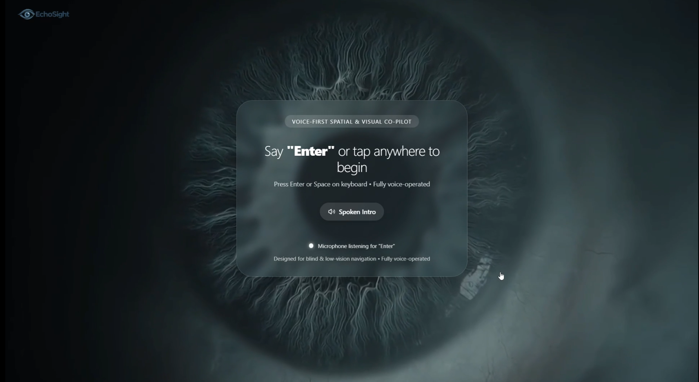
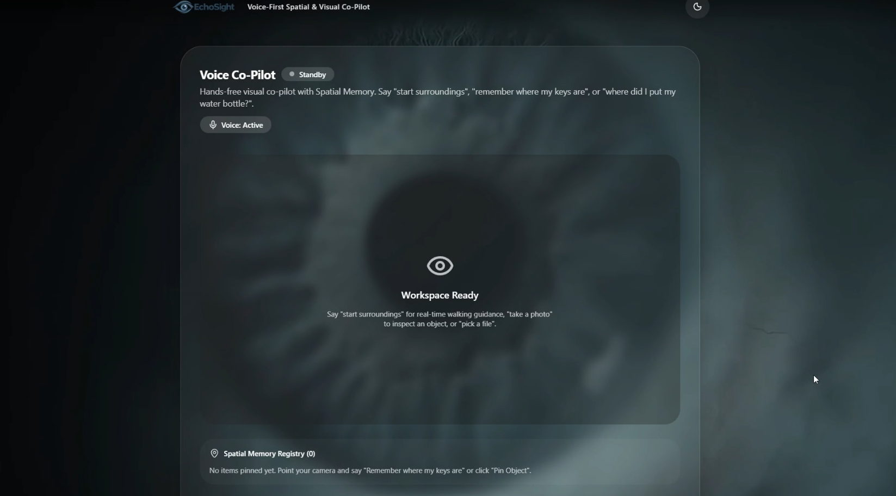
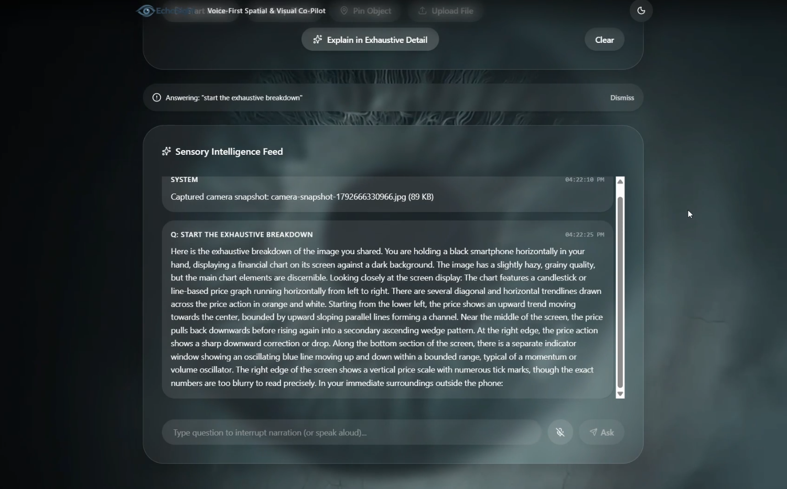
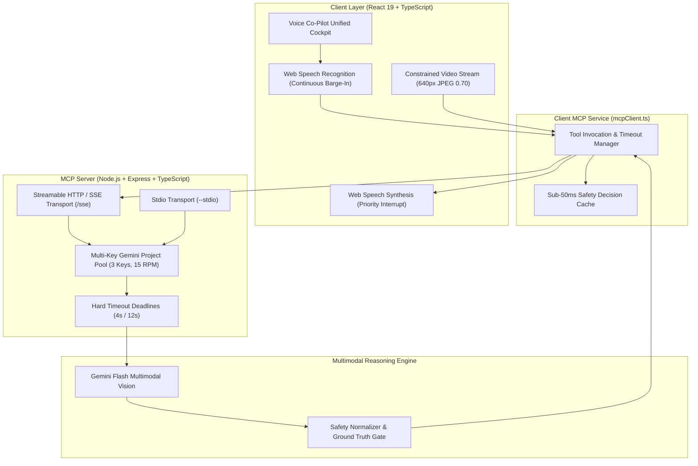

<div align="center">

# 👁️ EchoSight
### *100% Hands-Free Voice-First Spatial & Visual Co-Pilot for the Blind & Low-Vision*
**Real-Time Collision Radar • 3D Spatial Memory Registry • Model Context Protocol (MCP) • Alexa+ Track**

[](https://developer.amazon.com/en-US/alexa)
[](https://modelcontextprotocol.io/)
[](https://ai.google.dev/)
[](https://react.dev/)
[](https://www.typescriptlang.org/)
[](#-100-hands-free-eyes-free-experience)

<br/>



<br/>

> **"Sight is not just photons hitting a retina—it is freedom, spatial confidence, and the dignity to walk into the unknown without fear. EchoSight does not just describe the world; it guides your footsteps through it."**

---

</div>

## 📑 Table of Contents
1. [The Problem: The Dangerous Paradox of Modern Assistive Tech](#-the-problem-the-dangerous-paradox-of-modern-assistive-tech)
2. [The Solution: 100% Hands-Free Autonomous Co-Pilot](#-the-solution-100-hands-free-autonomous-co-pilot)
3. [Target Audience & Beneficiaries](#-target-audience--beneficiaries)
4. [100% Hands-Free, Eyes-Free Experience](#-100-hands-free-eyes-free-experience)
5. [The Alexa+ Track: Eyes for the Next Generation of Voice AI](#-the-alexa-track-eyes-for-the-next-generation-of-voice-ai)
6. [Visual Showcase & System Tour](#-visual-showcase--system-tour)
7. [Core Capabilities & Feature Deep-Dive](#-core-capabilities--feature-deep-dive)
8. [Technical Architecture & MCP Implementation](#-technical-architecture--mcp-implementation)
9. [Tech Stack](#-tech-stack)
10. [Quick Start & Setup Instructions](#-quick-start--setup-instructions)
11. [Acknowledgments](#-acknowledgments)

---

## 🚨 The Problem: The Dangerous Paradox of Modern Assistive Tech

Over **2.2 billion people** live with visual impairment or blindness across the globe. In an era where artificial intelligence can diagnose rare diseases and compose symphonies, the day-to-day reality for a blind person navigating their own home or a crowded street remains fraught with physical danger and cognitive exhaustion.

Existing assistive technologies suffer from three critical systemic failures:

```
┌─────────────────────────────────────────────────────────────────────────────┐
│                      THE ASSISTIVE TECHNOLOGY PARADOX                       │
├────────────────────────┬────────────────────────────────────────────────────┤
│ 1. The Touchscreen     │ Most "vision apps" are visual smartphone apps with │
│    Trap                │ accessibility bolted on as an afterthought. Blind  │
│                        │ users are forced to tap flat, featureless glass    │
│                        │ screens, dismiss modals, and hunt for buttons.     │
├────────────────────────┼────────────────────────────────────────────────────┤
│ 2. The Poetic Caption  │ When facing a hazard, generic multimodal models    │
│    Failure             │ output 60-word poetic captions ("A well-lit room   │
│                        │ with ceramic tiles and modern furniture..."). A    │
│                        │ blind person does not need poetry; they need:      │
│                        │ "Stop! Wall directly ahead."                       │
├────────────────────────┼────────────────────────────────────────────────────┤
│ 3. The Spatial Memory  │ Losing a white cane, keys, smartphone, or medicine │
│    Black Hole          │ turns a home into a minefield. Once an object leaves│
│                        │ physical touch, it effectively ceases to exist.    │
└────────────────────────┴────────────────────────────────────────────────────┘
```

When walking blind, **latency is not an annoyance—it is a collision**. A 3-second delay in warning someone about a closed door, downward stairwell, or low coffee table results in real physical trauma.

---

## 💡 The Solution: 100% Hands-Free Autonomous Co-Pilot

**EchoSight** re-imagines assistive vision from the ground up as a **100% eyes-free, voice-operated spatial companion**. 

EchoSight transforms standard camera hardware into a real-time sensory radar that acts like a vigilant, sighted companion walking beside you:

* **Urgent Collision Radar:** Analyzes footsteps and walking vectors at an adaptive 2.5-second cadence, giving crisp, authoritative directional cues (*"Hold on. Stop right there, wall directly ahead."*, *"Doorway ahead, step through carefully into the room."*).
* **3D Spatial Memory Registry:** Allows users to casually pin personal objects in spatial memory (*"Remember where my keys are"*), anchoring items relative to physical room landmarks and guiding users back to them on demand.
* **Instant Conversational Barge-In:** Real-time conversational interruption allows users to speak over EchoSight mid-sentence to ask urgent questions or halt commands without waiting for audio playback to finish.
* **Zero UI Touch Dependency:** From startup greeting to camera switches, live scans, photo captures, and deep chart analysis, **every single action is 100% hands-free and voice-driven**.

---

## 🎯 Target Audience & Beneficiaries

EchoSight is engineered specifically for users who cannot rely on visual interfaces:

1. **Totally Blind Individuals:** Users who require real-time audio guidance to navigate indoor corridors, avoid collisions with open cabinet doors, and safely cross thresholds.
2. **Low-Vision & Legally Blind Navigators:** Individuals with macular degeneration, glaucoma, or severe diabetic retinopathy who need proactive high-contrast verbal cues and text transcription.
3. **Visually Impaired Students & Professionals:** Knowledge workers who need exhaustive visual deconstruction of complex infographics, financial charts, documents, and sports scorecards without visual assistance.
4. **Elderly Individuals with Degenerative Vision Loss:** Seniors who find smartphone touchscreens confusing or inaccessible and benefit from pure conversational voice commands.

---

## 🎙️ 100% Hands-Free, Eyes-Free Experience

```
  ┌────────────────────────────────────────────────────────────────────────┐
  │                 ZERO TOUCHSCREEN INTERACTION REQUIRED                  │
  │                                                                        │
  │   🗣️ "Enter"              ──► Unlocks audio gateway & greets user     │
  │   🗣️ "Start Surroundings" ──► Activates walking radar & camera stream │
  │   🗣️ "Can I move forward?"──► Instant sub-50ms walking path clearance │
  │   🗣️ "Remember my keys"   ──► Pins item 3D landmark to spatial memory  │
  │   🗣️ "Where are my keys?" ──► Directional audio navigation to item    │
  │   🗣️ "Take a photo"       ──► Captures freeze-frame inspection         │
  │   🗣️ "Analyze it"         ──► Exhaustive visual data breakdown        │
  │   🗣️ "Stop"               ──► Instantly kills camera stream & audio   │
  └────────────────────────────────────────────────────────────────────────┘
```

In EchoSight, **the voice is the interface**. The application features an automatic auditory handshake on launch:
* It speaks its welcome greeting aloud: *"EchoSight. Voice-First Spatial and Visual Co-Pilot. Say Enter or tap anywhere to begin."*
* The user says **"Enter"**, and the system immediately transitions to the cockpit.
* Users never need to touch the phone screen, search for UI controls, or adjust sliders.

---

## ⚡ The Alexa+ Track: Eyes for the Next Generation of Voice AI

As voice assistants evolve into agentic, proactive companions under **Alexa+**, the missing link has always been **physical vision and spatial grounding**. Traditional voice assistants are disembodied brains that can tell you the weather or set a timer, but cannot see the door you are about to walk into or remember which table you placed your glasses on.

EchoSight serves as the definitive reference implementation for **Alexa+ Spatial Intelligence**:

1. **Model Context Protocol (MCP) Architecture:** EchoSight exposes its visual cortex as standardized MCP tools running over **Streamable HTTP/SSE (Server-Sent Events)** and **Stdio**. Any Alexa+ agent can dynamically invoke EchoSight tools to inspect surroundings, pin objects, or verify walking paths.
2. **Proactive Conversational Autonomy:** EchoSight does not just answer when spoken to; its active radar proactively interrupts when an imminent obstacle appears, matching the conversational agency championed by Alexa+.
3. **Decoupled Safety & Context Loops:** Urgent safety checks run on a priority cadence (2.5s), while ambient contextual descriptions run in the background (12–30s), ensuring conversational breadth never compromises real-time human safety.

---

## 📸 Visual Showcase & System Tour

<div align="center">
  <table width="100%">
    <tr>
      <td width="50%" align="center">
        
        <br />
        <b>Unified Voice Co-Pilot Stage (Standby Mode & Spatial Memory Registry)</b>
      </td>
      <td width="50%" align="center">
        
        <br />
        <b>Sensory Intelligence Feed (Exhaustive Financial Chart Breakdown)</b>
      </td>
    </tr>
  </table>
</div>

---

## 🚀 Core Capabilities & Feature Deep-Dive

### 1. Real-Time Walking Radar (Dual-Tier Safety Architecture)
* **Sub-Second Path Safety:** Evaluates forward walking vectors at an adaptive 2.5-second cadence (utilizing multi-key pooling) or 5-second baseline.
* **Fail-Safe Decision Normalization:** If a visual frame is blurry, timed out, or ambiguous, EchoSight **never** defaults to "clear". It strictly announces: *"Stop. Path not verified."*
* **Directional Threshold & Doorway Guidance:** Detects openings and doorways off-axis: *"Stop, wall directly in front of you. The doorway is to your right—turn right."*

### 2. 3D Spatial Memory & Permanent Landmark Pinning
* **Object Anchoring:** Point the camera at any personal item and say *"Remember where my keys are"*. EchoSight anchors the item relative to permanent room structures (*"Pinned your keys on the wooden desk, two feet to the right of the laptop"*).
* **Conversational Retrieval:** Asking *"Where did I put my keys?"* searches the spatial registry and cross-references live camera frames to provide directional guidance back to the object.

### 3. Sub-50ms Cached Navigation Q&A
* When a user asks *"Can I move forward?"* or *"Where should I walk?"* while the radar is running, EchoSight checks its fresh (<3000ms) safety state and answers **instantly in under 50 milliseconds**, bypassing external API round-trips for immediate walking confidence.

### 4. Instant Conversational Barge-In Interruption
* Speech synthesis is integrated with full acoustic echo suppression and continuous listening. The millisecond a user utters a syllable or command like *"Stop"*, all ongoing system audio cuts off instantly to prioritize user input.

### 5. Exhaustive Multimodal Visual Breakdown
* Beyond rapid navigation, users can say *"Take a photo"* and *"Analyze it"* to receive patient, structured breakdowns of documents, medicine packaging, complex financial infographics, and sports scorecards.

### 6. Hardware-Level Camera Teardown
* Saying *"Stop"*, *"Stop camera"*, or *"Turn off camera"* immediately terminates all active video tracks and shuts off camera sensor hardware, preserving device battery and user privacy.

---

## 🏗️ Technical Architecture & MCP Implementation

EchoSight implements the **Model Context Protocol (MCP)** specification (2025-11-25+), allowing client applications and AI agents to invoke specialized sensory tools over streamable transports:



### Official MCP Tool Registry

| Tool Name | Transport | Purpose | Output Format |
|---|---|---|---|
| `describe_surroundings` | SSE / Stdio | Live camera surroundings & hazard radar | Spoken spatial cues + directional insights |
| `check_walking_path` | SSE / Stdio | Sub-second collision avoidance check | Normalized safety state (`clear`, `stop`, `slow`, etc.) |
| `pin_spatial_object` | SSE / Stdio | Anchors object relative to permanent room landmarks | JSON Landmark schema + spoken confirmation |
| `locate_spatial_object` | SSE / Stdio | Searches spatial memory & cross-checks live camera | Directional audio navigation to item |
| `analyze_visual` | SSE / Stdio | Exhaustive visual breakdown of charts, maps, scenes | Structured multi-paragraph analysis |
| `analyze_video` | SSE / Stdio | Chronological narration of recorded video clips | Continuous narrative breakdown |
| `analyze_scorecard` | SSE / Stdio | Sports scorecard analysis & match momentum | Voice summary of wickets, runs, and rates |
| `ask_followup` | SSE / Stdio | Conversational Q&A grounded in live context | Punchy conversational response |
| `ping` | SSE / Stdio | Protocol handshake and uptime diagnostic | Health confirmation & session count |

---

## 💻 Tech Stack

### Frontend Client
* **Framework:** React 19.3 with TypeScript (Strict Mode)
* **Bundler & Tooling:** Vite 8.3 with `@tailwindcss/vite`
* **Styling:** Tailwind CSS 4.3 with custom glassmorphism design tokens
* **Icons:** Lucide React
* **Speech Engine:** Native Web Speech API (`SpeechRecognition` & `SpeechSynthesis`) with continuous barge-in and echo cancellation

### Backend MCP Server
* **Runtime:** Node.js v22+ / v24+
* **Server Framework:** Express 4.21 with CORS
* **Protocol SDK:** `@modelcontextprotocol/sdk` (Model Context Protocol official SDK)
* **Validation:** Zod 3.24 schema validation
* **Transport Modes:** Streamable HTTP / Server-Sent Events (SSE) on `/sse` and Stdio transport via `--stdio`

### Vision & AI Models
* **Primary Vision Engine:** Google Gemini Flash Multimodal (`@google/genai`)
* **Key Pool Management:** Server-side 3-key project pool with rolling 60-second window request tracking and automatic rotation
* **Audio Intelligence Backup:** Groq Whisper Large v3 Turbo

---

## 🛠️ Quick Start & Setup Instructions

### Prerequisites
* **Node.js:** v18.0.0 or higher (v22+ recommended)
* **npm:** v9.0.0 or higher
* **Google Gemini API Key:** From [Google AI Studio](https://aistudio.google.com/)

### 1. Clone the Repository
```bash
git clone https://github.com/Manthan-cpp/EchoSight-AI.git
cd EchoSight-AI
```

### 2. Configure Environment Variables
Create a `.env` file in the `server/` directory:

```ini
PORT=3001
GEMINI_MODEL=gemini-3.5-flash-lite

# Primary Gemini API Key
GEMINI_API_KEY=your_gemini_api_key_here

# Optional: Add secondary project keys to unlock 2.5s radar cadence
GEMINI_API_KEY1=your_second_project_key
GEMINI_API_KEY2=your_third_project_key

# Optional: Groq API Key for Whisper fallback
GROQ_API_KEY=your_groq_api_key_here
```

### 3. Install Dependencies & Build

```bash
# Install and build MCP server
cd server
npm install
npm run build
cd ..

# Install and build web client
cd client
npm install
npm run build
cd ..
```

### 4. Run Locally

Open two terminal windows:

**Terminal 1: Start MCP Server**
```bash
cd server
npm start
# Server listens on http://localhost:3001 (SSE on /sse, Health on /health)
```

**Terminal 2: Start Web Client**
```bash
cd client
npm run dev
# Vite dev server live at http://localhost:5173
```

### 5. Inspecting MCP Tools via Official Inspector
You can verify and test all 8 MCP tools using Anthropic's official MCP Inspector:

```bash
cd server
npm run inspector
```

---

## 🏆 Acknowledgments

* **Amazon Alexa+ Team:** For inspiring the voice-first paradigm and agentic spatial intelligence.
* **Model Context Protocol (MCP) Community:** For establishing open standards for LLM-tool connectivity.
* **Google DeepMind & Gemini API Team:** For high-speed multimodal vision models making real-time accessibility possible.
* **Open Source Accessibility Advocates:** Dedicated to building tools that ensure technology leaves no one behind.

---

<div align="center">

**EchoSight — Giving Voice to Vision.**  
Built with ❤️ for the Alexa+ Track Hackathon 2026.

</div>
